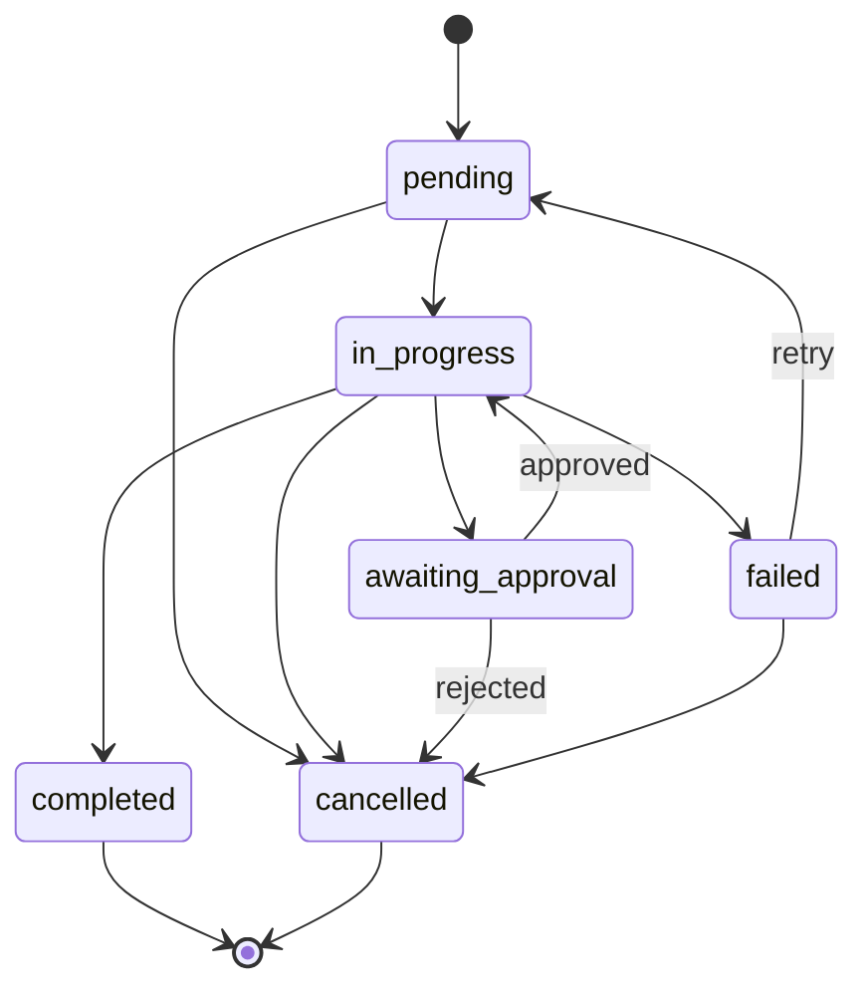

# Day 64 — Foundation, Architecture and Dashboard

**Objective:** Understand what business automation is, design how the Operations Center will work, and build the foundation: the project structure, the Task model with its status rules, a database, configuration, and an initial dashboard.

---

## 📖 Theory

### What is business automation?

Business automation means performing repetitive business tasks automatically, using predefined rules and software.

Example: a customer request arrives, the system creates a task, assigns a priority, and notifies the person responsible. Nobody has to copy anything by hand, and the same request is handled the same way every time.

Automation is worth building when a task is **repetitive, follows clear rules, and happens often enough** that doing it by hand wastes time or causes mistakes. It is a poor fit when every case is different and needs judgement.

### Automation vs. AI agent

| Automation (rules) | AI agent |
|---|---|
| Follows predefined rules | Decides from context |
| If X, then Y | Understands a request and chooses a suitable action |
| Best for predictable, routine workflows | Best for ambiguous tasks and flexible decisions |

The Operations Center uses **both**. A simple rule of thumb: *if you can write the rule down, use a rule. Use the AI where the input is language or the decision cannot be written as a rule.*

| Situation | Use |
|---|---|
| "A task marked urgent gets high priority" | Rule |
| "Move a completed task out of the pending list" | Rule |
| "Turn a vague customer message into a clear task title" | AI |
| "Draft a polite reply to this email" | AI (with human approval before it is sent) |

Rules are fast, free, predictable and easy to test. An AI step costs time and money and can be wrong, so it should earn its place.

### How the Operations Center is organised

Four layers, matching your plan:

| Layer | What it does | Where it lives |
|---|---|---|
| **1. Central dashboard** | Shows tasks, customers, reports and activity | `app.py`, `pages/`, `components/` |
| **2. Workflow engine** | Rules, priorities, task routing | `src/workflows/` |
| **3. AI + tools** | Email, scheduling, CRM, reporting | `src/agents/`, `src/integrations/`, `src/services/` |
| **4. Execution and monitoring** | Approval, result, status, activity log | `src/workflows/approval_manager.py`, `src/services/activity_service.py`, `src/services/notification_service.py` |

`src/core/` (configuration, database, schemas, security) is the shared foundation underneath all four.

A typical workflow:

```
Trigger  →  Rules / AI agent  →  Human approval (if it leaves the system)  →  Execute  →  Notify + log
(request)   (analyse & decide)                                              (action)     (status & result)
```

### The Task model

A task has exactly these fields:

| Field | Meaning |
|---|---|
| `id` | Unique number, assigned by the database |
| `title` | What needs to be done (1 to 200 characters, whitespace trimmed) |
| `category` | `reporting`, `crm`, `email`, `scheduling`, `analysis`, `general` |
| `priority` | `low`, `medium`, `high` |
| `status` | Where the task is in its lifecycle |
| `created_at` | When it was created (UTC) |

### Task states: a small state machine

A task is always in exactly one status, and it can only move to certain other statuses. Writing this down as rules means an impossible situation (a completed task that is "pending" again) cannot happen by accident.

| Status | Meaning |
|---|---|
| `pending` | Created, not started |
| `in_progress` | Being worked on, or its workflow is running |
| `awaiting_approval` | Waiting for a human before anything outbound happens |
| `completed` | Finished (final) |
| `failed` | The workflow failed; it can be retried |
| `cancelled` | Abandoned or rejected (final) |

Allowed moves (generated from the real rules in `schemas.py`):

| From | Can move to |
|---|---|
| `pending` | `cancelled`, `in_progress` |
| `in_progress` | `awaiting_approval`, `cancelled`, `completed`, `failed` |
| `awaiting_approval` | `cancelled`, `in_progress` |
| `completed` | none (final state) |
| `failed` | `cancelled`, `pending` |
| `cancelled` | none (final state) |



Two statuses exist before they are fully used. `awaiting_approval` is used from Day 66 (human approval) and `failed` from Day 65 (workflow errors). Defining them now means the dashboard and the rules do not have to change later.

**"Overdue" is not a status here.** The mockup shows an Overdue count, but being overdue depends on a due date, and the Day 64 Task model has none. It is better computed from a due date than stored as a status that someone has to keep updating. If due dates are added later, overdue becomes a calculation.

### Automation rules: trigger, condition, action

Every automation rule has the same shape:

```
TRIGGER    something happens          (a task is created)
CONDITION  a check on the data        (the title contains "urgent")
ACTION     what the system does       (set the priority to high)
```

Good rules are **explicit** (no hidden behaviour), **deterministic** (the same input gives the same result), **testable**, and **safe to run twice**. Rules are built on Day 65.

### Storing the data: SQLite, schema and migrations

- **SQLite** is a full SQL database in one file, included with Python, needing no server. It suits a project of this size.
- **`database/schema.sql`** describes the tables. The `CHECK` constraints repeat the allowed values, so even a direct edit of the database cannot store a nonsense status. A test keeps those lists identical to the Python enums.
- **`database/migrations/`** is for later changes to the structure. Instead of editing the database by hand, each change is a small SQL file applied in order. It is empty on Day 64 and is used from Day 65.
- **The database file is created automatically** the first time the app runs, and it is **not committed to Git**. What Git tracks is the schema and the migrations, which are enough to rebuild the database anywhere.
- **Every query uses `?` parameters** and never pastes text into the SQL, so a title like `x'); DROP TABLE tasks;--` is stored as plain text.
- **SQLite ignores foreign keys unless you turn them on for each connection** (`PRAGMA foreign_keys = ON`). The foundation does this in one place so later tables can rely on it.

### Configuration and secrets

- Settings are read from the **environment first, then Streamlit secrets**, so the same code runs locally (a `.env` file) and on Streamlit Cloud (the host's secrets).
- **`.env.example` lists variable names only.** Real keys, OAuth tokens and passwords never go into the repository, and `.env` is in `.gitignore`.

### The dashboard foundation

- **Streamlit multipage with `st.navigation`.** `app.py` does the shared setup (page configuration, theme, database, sidebar) and runs the chosen page from `pages/`. A page is added to the navigation on the day it is built; only the Dashboard exists on Day 64.
- **Real numbers only.** The dashboard shows what is in the database: total, in progress, awaiting approval and completed tasks, a status chart, and the recent tasks. It does **not** show "Emails sent" or "Meetings scheduled" yet, because those features do not exist. Showing invented numbers would break the project rule that simulated functionality is never presented as real.
- **Sample data is labelled.** A fresh install loads 12 sample tasks (`data/sample_tasks.csv`) into an **empty** table only, and the page shows a "Sample data" label while this is on.
- **Empty state.** With no tasks, the page says so instead of showing zeros that look like data.
- **Components** (`components/`) are small reusable pieces: header, metric cards, task table, chart, sidebar footer. The status shown in the sidebar is a real database check.

### A Streamlit gotcha you will meet

`st.markdown` treats text as Markdown, and a Markdown HTML block ends at the first **blank line**. A stylesheet or HTML snippet that spans several lines with blank lines in it is cut in two, and the rest is printed on the page as plain text. The fix used here: collapse every HTML or CSS fragment to **one line** before rendering, and escape any text that comes from the database so it cannot inject HTML.

---

## 💻 Coding Exercise

Build the foundation. Files for Day 64 (from the repository structure):

| File | Purpose |
|---|---|
| `requirements.txt`, `.env.example`, `.gitignore` | Dependencies, setting names, what Git must ignore |
| `app.py` | Entry point: setup and navigation |
| `src/core/config.py` | Settings and paths |
| `src/core/schemas.py` | Task model, enums, status rules |
| `src/core/database.py` | SQLite storage for tasks |
| `database/schema.sql` | The tasks table |
| `data/sample_tasks.csv` | 12 sample tasks |
| `components/theme.py`, `header.py`, `metric_cards.py`, `tables.py`, `charts.py`, `sidebar.py` | Dashboard building blocks (`theme.py` is one small addition to the structure, for the colours and CSS) |
| `pages/01_Dashboard.py` | The dashboard page |
| `docs/architecture.md` | The workflow architecture (you write this in the Mini Project) |

**The Task model and its rules** (`src/core/schemas.py`, imports omitted):

```python
class Category(str, Enum):
    REPORTING = "reporting"
    CRM = "crm"
    EMAIL = "email"
    SCHEDULING = "scheduling"
    ANALYSIS = "analysis"
    GENERAL = "general"


class Priority(str, Enum):
    LOW = "low"
    MEDIUM = "medium"
    HIGH = "high"


class Status(str, Enum):
    PENDING = "pending"                      # created, not started
    IN_PROGRESS = "in_progress"              # being worked on / its workflow is running
    AWAITING_APPROVAL = "awaiting_approval"  # waiting for a human before anything outbound happens (Day 66)
    COMPLETED = "completed"                  # finished (terminal)
    FAILED = "failed"                        # the workflow failed; can be retried
    CANCELLED = "cancelled"                  # abandoned or rejected (terminal)


# Where a task is allowed to go next. Anything not listed is refused.
ALLOWED_TRANSITIONS: Dict[Status, Set[Status]] = {
    Status.PENDING: {Status.IN_PROGRESS, Status.CANCELLED},
    Status.IN_PROGRESS: {Status.AWAITING_APPROVAL, Status.COMPLETED, Status.FAILED, Status.CANCELLED},
    Status.AWAITING_APPROVAL: {Status.IN_PROGRESS, Status.CANCELLED},   # approved -> carry on; rejected -> cancel
    Status.FAILED: {Status.PENDING, Status.CANCELLED},                  # retry or give up
    Status.COMPLETED: set(),
    Status.CANCELLED: set(),
}


class InvalidTransition(ValueError):
    """A status change that the rules do not allow."""


class TaskNotFound(LookupError):
    pass


def utc_now() -> datetime:
    return datetime.now(timezone.utc)


class TaskCreate(BaseModel):
    """What a person (or a workflow) provides to create a task. The system adds id, status and created_at."""

    model_config = ConfigDict(str_strip_whitespace=True)

    title: str = Field(min_length=1, max_length=200)
    category: Category = Category.GENERAL
    priority: Priority = Priority.MEDIUM


class Task(BaseModel):
    """A stored task."""

    model_config = ConfigDict(str_strip_whitespace=True)

    id: int
    title: str = Field(min_length=1, max_length=200)
    category: Category
    priority: Priority
    status: Status
    created_at: datetime

    def can_move_to(self, new_status: Status) -> bool:
        return Status(new_status) in ALLOWED_TRANSITIONS[self.status]

    def move_to(self, new_status: Status) -> "Task":
        """Return a copy of this task in the new status, or raise InvalidTransition."""
        new_status = Status(new_status)
        if not self.can_move_to(new_status):
            allowed = ", ".join(sorted(s.value for s in ALLOWED_TRANSITIONS[self.status])) or "none (final state)"
            raise InvalidTransition(f"A {self.status.value} task cannot become {new_status.value}. Allowed: {allowed}.")
        return self.model_copy(update={"status": new_status})
```

**The table** (`database/schema.sql`):

```sql
-- AI Operations Center: database schema (Day 64).
-- The database file itself (operations.db) is created automatically on first run and is not committed.
-- This schema and the files in migrations/ are what is tracked.

CREATE TABLE IF NOT EXISTS tasks (
    id          INTEGER PRIMARY KEY AUTOINCREMENT,
    title       TEXT NOT NULL CHECK (length(trim(title)) > 0 AND length(title) <= 200),
    category    TEXT NOT NULL CHECK (category IN ('reporting', 'crm', 'email', 'scheduling', 'analysis', 'general')),
    priority    TEXT NOT NULL CHECK (priority IN ('low', 'medium', 'high')),
    status      TEXT NOT NULL CHECK (status IN ('pending', 'in_progress', 'awaiting_approval', 'completed', 'failed', 'cancelled')),
    created_at  TEXT NOT NULL
);

CREATE INDEX IF NOT EXISTS idx_tasks_status ON tasks(status);
CREATE INDEX IF NOT EXISTS idx_tasks_created ON tasks(created_at);
```

**Every database connection and every status change** (`src/core/database.py`). A status can only change through the rules, and a refused change leaves the database untouched:

```python
@contextmanager
def connect() -> Iterator[sqlite3.Connection]:
    conn = sqlite3.connect(config.DATABASE_PATH)
    conn.row_factory = sqlite3.Row
    conn.execute("PRAGMA foreign_keys = ON")   # SQLite ignores foreign keys unless this is set on every connection
    try:
        yield conn
        conn.commit()
    except Exception:
        conn.rollback()
        raise
    finally:
        conn.close()


def update_status(task_id: int, new_status: Status) -> Task:
    """Change a task's status if the rules allow it. Raises TaskNotFound or InvalidTransition (and changes nothing)."""
    task = get_task(task_id)
    if task is None:
        raise TaskNotFound(f"No task with id {task_id}.")
    updated = task.move_to(new_status)
    with connect() as conn:
        conn.execute("UPDATE tasks SET status = ? WHERE id = ?", (updated.status.value, task_id))
    return updated
```

**The entry point** (`app.py`):

```python
"""
app.py
Entry point of the AI Operations Center (Streamlit).

    streamlit run app.py

The shared setup lives here (page config, theme, database, sidebar); each page lives in pages/.
Pages are added to the navigation below as they are built.
"""

from pathlib import Path

import streamlit as st

from components.sidebar import render_sidebar_footer
from components.theme import inject_css
from src.core import config, database

st.set_page_config(page_title=config.APP_NAME, page_icon="◍", layout="wide")

# The database file is created here on first run. Sample tasks load only into an empty table.
database.init_db()
if config.LOAD_SAMPLE_DATA:
    database.seed_sample_tasks()

inject_css()
st.logo(str(Path(__file__).parent / "assets" / "logo.png"), size="large")

navigation = st.navigation([
    st.Page("pages/01_Dashboard.py", title="Dashboard", icon=":material/dashboard:", default=True),
    # 02_Tasks.py (Day 65), 03_Workflows.py (Day 65), 04_Email_Assistant.py (Day 66), 05_Scheduling.py (Day 66),
    # 06_CRM.py (Day 67), 07_Reports.py (Day 68), 08_Notifications.py (Day 68)
])
render_sidebar_footer()
navigation.run()
```

**What was checked** (31 automated tests, run in a Linux environment with Python 3.12 and Streamlit 1.66):

| Area | Checked |
|---|---|
| Model | Title trimmed, empty / blank / 201-character titles rejected, invalid category or priority rejected |
| Status rules | All 36 status pairs: allowed moves work, every other move is refused; final states have no exit; a failed task can be retried |
| Schema | The `CHECK` lists in `schema.sql` equal the Python enums |
| Database | File created automatically (even in a missing folder); add / get / list; newest first; filters; refused change leaves the status unchanged; unknown id raises; foreign keys on |
| Safety | A malicious title is stored as plain text; the database itself refuses a bad status |
| Sample data | Loads once into an empty table (12 tasks: 4 completed, 2 in progress, 3 pending, 1 awaiting approval, 1 failed, 1 cancelled); never touches a non-empty table; a bad row stops everything and names the line |
| Repo rules | `.gitignore` covers `.env`, secrets and `database/*.db`; `.env.example` holds names only; no secret or database file is present in the folder |
| Components | Greeting by hour; a title like `<script>` is escaped; all generated HTML is one line; the donut's segments add up to the full circle and skip zero counts; empty data does not divide by zero |
| The running dashboard | With sample data it shows 12 tasks, the sample label and 33% completed; with an empty database it shows the "no tasks yet" message and no label |

**Not checked:** how the page actually looks in a browser, the sidebar colour rules (written for Streamlit's current element names and not seen on screen), running on Python 3.10 (only the syntax was checked for 3.10 safety), and any deployment.

---

## 🛠 Mini Project

**Run and break the foundation**

1. **Set up and run.** Create the virtual environment, install `requirements.txt`, copy `.env.example` to `.env`, then run from the **project root**:
   ```bash
   streamlit run app.py
   ```
2. **Check the database appeared.** `database/operations.db` should now exist. Run `git status` and confirm Git does **not** list it.
3. **Compare the numbers.** Open the database (`sqlite3 database/operations.db "SELECT status, COUNT(*) FROM tasks GROUP BY status;"`) and confirm it matches the dashboard.
4. **Walk a task through its life** in a Python shell:
   ```python
   from src.core import database
   from src.core.schemas import TaskCreate, Status
   t = database.add_task(TaskCreate(title="Test task", category="email", priority="high"))
   database.update_status(t.id, Status.IN_PROGRESS)
   database.update_status(t.id, Status.COMPLETED)
   database.update_status(t.id, Status.PENDING)   # must be refused
   ```
5. **Break it on purpose.** Try an empty title, a 300-character title, and a title containing `<script>`; check how each is handled and how the dashboard shows the last one.
6. **Delete `operations.db` and run the app again.** It should be recreated with the sample tasks.
7. **Set `LOAD_SAMPLE_DATA=false`** with a fresh database and check the empty-state message.
8. **Write `docs/architecture.md`:** the four layers, the workflow diagram, and the task state diagram, in your own words.
9. **Write the Day 64 entry in `journal.md`.**

Done means you can show each of these happening, including the refused change in step 4.

---

## 🧠 Quiz

1. When is automation the right tool, and when is an AI agent?
2. Why does a task need a state machine instead of a free-text status?
3. Why are `awaiting_approval` and `failed` defined now when they are first used on Days 65 and 66?
4. Why is "Overdue" not a status in this model?
5. The database file is not committed. What is committed, and why is that enough?
6. Why does the dashboard not show "Emails sent: 8" yet?
7. A task title contains HTML. What stops it from breaking the page?

*(Try answering from memory first, then check the theory section above.)*

---

## 🐞 Common Errors

| Error | Likely Cause | Fix |
|---|---|---|
| CSS or HTML shows up as text on the page | A multi-line fragment with blank lines passed to `st.markdown` | Collapse it to one line before rendering |
| `ModuleNotFoundError: components` or `src` | Running from the wrong folder, or `streamlit run src/app.py` | Run from the project root: `streamlit run app.py` |
| The files ended up in a folder inside a folder | The zip or repo was extracted into another folder with the same name | Use the folder that contains `app.py` as the project root |
| `operations.db` appears in `git status` | `.gitignore` is missing or wrong | Check `database/*.db` is listed; if it was already committed, remove it from Git's index |
| A completed task becomes pending again | Status changed with raw SQL, bypassing the rules | Change status only through `update_status` |
| Foreign keys are not enforced | `PRAGMA foreign_keys` is off by default in SQLite | Set it on every connection (done in `connect()`) |
| Sample tasks appear twice | Seeding ran into a table that already had rows | Seeding only runs into an empty table |
| `InvalidTransition` | The move is not in the allowed table | Check the table above, or the task's current status |
| A real key appears in `.env.example` | Copied from `.env` | Keep only names in `.env.example`; rotate any key that was committed |
| The greeting says "morning" at night on the host | Streamlit Cloud runs on UTC | Use a configured time zone if it matters |

---

## ✅ Checklist

- [ ] Business automation, automation vs. AI agent, and the four layers understood
- [ ] Repository structure created and the Day 64 files in place
- [ ] Virtual environment, `requirements.txt` and `.env.example` set up
- [ ] Task model and status rules built and tested
- [ ] Database created automatically, and not tracked by Git
- [ ] Initial dashboard running with real numbers and a "Sample data" label
- [ ] `docs/architecture.md` written
- [ ] `journal.md` updated
- [ ] Git commit made

---

## 📂 GitHub Push

```bash
git add .
git commit -m "Day 64: Foundation, architecture and dashboard"
git push
```

---

## 🧠 Skill Learned

Business automation fundamentals + task and workflow state modelling + project foundation (database, configuration, dashboard)
