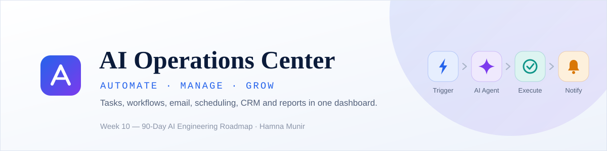

<p align="center">
  
</p>

<p align="center">
  
  
  
  
  
  
  
  
</p>

<p align="center">
  A centralized, AI-powered operations dashboard that manages business tasks, runs automation workflows, and shows the status and result of every action.<br/>
  Tenth deliverable of a <b>90-day AI Engineering roadmap</b> (Week 10, Days 64–70).
</p>

---

## 📑 Table of Contents

- [Overview](#-overview)
- [Project Status](#-project-status)
- [What It Will Do](#-what-it-will-do)
- [Automation vs AI Agent](#-automation-vs-ai-agent)
- [How It Works](#-how-it-works)
- [Task Model](#-task-model)
- [Design Principles](#-design-principles)
- [Integration Status](#-integration-status)
- [Design Concept](#-design-concept)
- [Demo](#-demo)
- [Installation](#-installation)
- [How to Run](#-how-to-run)
- [Evaluation Plan](#-evaluation-plan)
- [Folder Structure](#-folder-structure)
- [Limitations](#-limitations)
- [Future Improvements](#-future-improvements)
- [Roadmap Context](#-roadmap-context)
- [Author](#-author)
- [License](#-license)

---

## 📖 Overview

**AI Operations Center** is a single dashboard for running the day-to-day operations of a small business. A request comes in, the system creates a task, assigns a priority, routes it through a workflow, lets an AI assistant help where language understanding is needed (drafting an email, summarising, deciding), asks a human to approve anything that leaves the system, and records the status and result of every step.

It brings together email drafting, scheduling, CRM-style workflows, reporting and notifications in one integrated system, and builds on the agent, tool and orchestration work from Weeks 7–9.

This is **Week 10** of a structured 90-day AI Engineering roadmap.

---

## 🚧 Project Status

This repository is being built day by day. The table shows what is planned and is updated as each day lands. **Nothing is marked done until it has been tested.**

Legend: ⬜ Planned · 🔄 In progress · ✅ Done and tested

| Day | Topic | Build | Status |
|---|---|---|---|
| 64 | Business automation fundamentals | Architecture, workflow design, task states, automation rules; repository, environment, configuration, initial dashboard, Task model | 🔄 Starting |
| 65 | Task and workflow engine | Create tasks, priorities, status tracking, workflow execution | ⬜ Planned |
| 66 | Email and scheduling automation | Email drafts, scheduling workflows, human approval | ⬜ Planned |
| 67 | CRM and business data | Customer records, follow-ups, workflow management | ⬜ Planned |
| 68 | Automated reporting and notifications | Metrics, reports, activity logs, workflow alerts | ⬜ Planned |
| 69 | Integration and system assembly | Connect the components, error handling, approval controls | ⬜ Planned |
| 70 | Testing, deployment and demo | End-to-end tests, README, screenshots, evaluation, Streamlit deployment | ⬜ Planned |

---

## 🧩 What It Will Do

| Module | Purpose | Planned for |
|---|---|---|
| **Dashboard** | One place to see tasks, customers, reports and recent activity | Day 64 (initial), grows each day |
| **Tasks and workflows** | Create tasks, set priority, track status, execute workflows | Day 65 |
| **Email assistant** | Draft emails with AI help; a human approves before anything is sent | Day 66 |
| **Scheduling** | Scheduling workflows with human approval | Day 66 |
| **CRM** | Customer records, follow-ups, CRM-style workflows | Day 67 |
| **Reports** | Metrics and reports computed from the system's own data | Day 68 |
| **Notifications and activity log** | Workflow alerts, plus a record of every action and its result | Day 68 |
| **AI assistant** | Language understanding, summarising and decisions where rules are not enough | Throughout |

---

## 🔀 Automation vs AI Agent

Both are used, each where it fits.

| Automation (rules) | AI agent |
|---|---|
| Follows predefined rules | Decides from context |
| If X, then Y | Understands a request and chooses a suitable action |
| Best for predictable, routine workflows | Best for ambiguous tasks and flexible decisions |

**Rules handle routine actions** (for example: a customer request arrives, create a task, assign a priority, notify the owner). **The AI agent helps where language understanding, summarising or judgement is needed** (for example: turning a vague request into a clear task, or drafting a reply).

---

## 🧱 How It Works

```
┌──────────────────────────────────────────────────────────────┐
│  1. Central Dashboard      tasks · customers · reports · activity
├──────────────────────────────────────────────────────────────┤
│  2. Workflow Engine        rules · priorities · task routing
├──────────────────────────────────────────────────────────────┤
│  3. AI + Tools             email · scheduling · CRM · reporting
├──────────────────────────────────────────────────────────────┤
│  4. Execution & Monitoring approval · result · status · activity log
└──────────────────────────────────────────────────────────────┘
```

A typical workflow:

```
Trigger  →  Rules / AI Agent  →  Human approval (if it leaves the system)  →  Execute  →  Notify + log
(request)   (analyse & decide)                                              (action)     (status & result)
```

---

## 📋 Task Model

The foundation built on Day 64. Every task has:

| Field | Meaning |
|---|---|
| `id` | Unique identifier |
| `title` | What needs to be done |
| `category` | The kind of work (for example reporting, CRM, email, scheduling) |
| `priority` | How urgent it is |
| `status` | Where it is in its lifecycle |
| `created_at` | When it was created |

The exact allowed values for category, priority and status, and the rules for moving between statuses, are defined on Day 64 and documented in `notes/day-64.md`.

---

## 🧭 Design Principles

- **Rules for routine, AI for ambiguity.** Do not use an AI agent where a simple rule is enough.
- **Human approval for outbound actions.** Nothing that leaves the system (an email, a calendar invitation) happens without an explicit approval.
- **Honest integrations.** Where a real external integration is available it is connected properly. Simulated functionality is labelled as simulated and is never presented as a real integration.
- **Every action is recorded.** Each action has a visible status and result in the activity log.
- **Concepts first, then code.** Each day starts with what it is and why it matters.
- **Verify before claiming.** A feature is reported as working only after it has been tested, including its failure cases.

---

## 🔌 Integration Status

What is real and what is simulated is tracked here, and updated only when it has been verified. Nothing is claimed in advance.

| Capability | Planned approach | Real external service? | Status |
|---|---|---|---|
| Email drafting | AI-drafted text, reviewed by a human | Not needed for drafting | ⬜ Not started |
| Sending email | Only after human approval | To be decided on Day 66 | ⬜ Not started |
| Scheduling / calendar | Scheduling workflow with approval | To be decided on Day 66 | ⬜ Not started |
| CRM | Built-in CRM-style records | No third-party CRM planned | ⬜ Not started |
| Reporting | Computed from the system's own data | Not needed | ⬜ Not started |
| Notifications | In-app alerts and activity log | In-app only unless stated otherwise | ⬜ Not started |

Features that need personal credentials (for example a real calendar account) may run only on a local machine. A deployed public demo will label anything simulated as simulated.

---

## 🎨 Design Concept

The visual target for the interface: a dark navigation sidebar, a light content area, KPI cards, a recent-tasks table, a task overview, quick actions, a recent-activity feed, a workflow overview and upcoming meetings.

<p align="center">
  
</p>

> **This is a concept mockup, not a screenshot of the running application.** The numbers and dates in it (12 tasks, 24 customers, 22 April 2025) are illustrative. Real screenshots are added on Day 70.

---

## 🎥 Demo

*(Screenshots of the running application will be added on Day 70. See `assets/screenshots/`.)*

---

## 📦 Installation

```bash
# 1. Clone the repository
git clone https://github.com/Hamna-Munir/10-AI-Operations-Center.git
cd 10-AI-Operations-Center

# 2. Create a virtual environment
python -m venv venv
source venv/bin/activate      # On Windows: venv\Scripts\activate

# 3. Install dependencies
pip install -r requirements.txt

# 4. Configure environment variables
cp .env.example .env          # On Windows: copy .env.example .env
# then add the keys needed by the modules you enable (LLM key; optional integrations)
```

---

## 🏃 How to Run

> The initial dashboard arrives on Day 64; other modules become available as their days land.

```bash
streamlit run src/app.py
# or: python -m streamlit run src/app.py

# Run the tests
pytest
```

---

## 🧪 Evaluation Plan

Day 70 evaluates the system end to end (`evaluation/evaluation.csv`). Planned checks:

| Area | What is checked |
|---|---|
| Task lifecycle | Tasks are created, prioritised and move through statuses correctly |
| Workflow execution | Rules route tasks as designed; the AI step is used only where intended |
| Approval controls | Nothing outbound happens without approval; a rejection stops the action |
| Failure handling | A failing step is reported with its status and does not break the rest |
| Reports | Report numbers match the underlying data |
| Notifications and activity log | Every action produces a log entry with its status and result |

Results will be published here once they have been measured.

---

## 📂 Folder Structure

*Planned structure. It may change as the days land.*

```
10-AI-Operations-Center/
│
├── README.md
├── LICENSE
├── .gitignore
├── requirements.txt
├── .env.example
│
├── src/
│   ├── app.py                 # Streamlit dashboard
│   ├── config.py
│   ├── models.py              # Task model
│   ├── workflow_engine.py     # tasks, priorities, status, workflow execution
│   ├── email_assistant.py
│   ├── scheduling.py
│   ├── crm.py
│   ├── reports.py
│   ├── notifications.py
│   └── activity_log.py
│
├── data/
├── tests/
│
├── evaluation/
│   └── evaluation.csv
│
├── notes/
│   ├── day-64.md
│   ├── day-65.md
│   ├── day-66.md
│   ├── day-67.md
│   ├── day-68.md
│   ├── day-69.md
│   └── day-70.md
│
├── docs/
│
├── assets/
│   ├── banner.svg
│   ├── design/
│   │   └── dashboard-concept.png
│   └── screenshots/
│
└── journal.md
```

---

## 📝 Limitations

The final limitations are documented on Day 70, after testing. Expected up front:

- AI-drafted content must be reviewed by a human before it is sent.
- Simulated integrations are labelled as simulated and do not affect any external system.
- Data is stored locally unless stated otherwise.

---

## 🔮 Future Improvements

- [ ] User accounts and roles
- [ ] More real integrations (additional email, calendar and CRM providers)
- [ ] Scheduled and recurring workflows
- [ ] Exporting reports as PDF
- [ ] Team collaboration (assign tasks to different people)

---

## 📅 Roadmap Context

This project is **Week 10** of a 90-day AI Engineering roadmap:

| Week | Project | Days |
|---|---|---|
| 7 | AI Meeting Agent | 43–49 |
| 8 | AI Business Agent | 50–56 |
| 9 | AI Multi-Agent System | 57–63 |
| **10** | **AI Operations Center** | **64–70** |

---

## 👩‍💻 Author

**Hamna Munir**
Software Engineering & AI/ML Student | Building deployable AI/ML projects

- GitHub: [@Hamna-Munir](https://github.com/Hamna-Munir)
- Hugging Face: [@Hamna27](https://huggingface.co/Hamna27)

---

## 📄 License

This project is licensed under the MIT License — see the [LICENSE](LICENSE) file for details.
