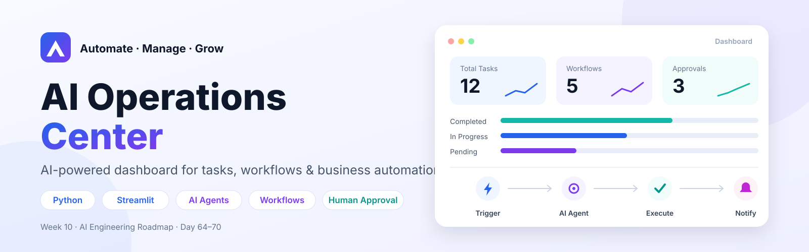

<p align="center">
  
</p>

<h1 align="center">AI Operations Center</h1>

<p align="center">
  A centralized, AI-powered dashboard that manages business tasks, runs automation workflows,<br>
  and shows the status and result of every action.
</p>

<p align="center">
  
  
  
  
</p>

---

## Overview

AI Operations Center brings the repetitive parts of day-to-day business operations into one system: task management, email drafting, scheduling, CRM-style follow-ups, reporting and notifications.

Routine actions are handled by **rule-based automation** (`if X, then Y`). Tasks that need language understanding, summarization or flexible decisions are handled by an **AI agent**. Sensitive actions go through **human approval** before they run.

> **Transparency note:** where a real external integration is connected, it is documented as such. Anything running on sample data or mock services is labelled as mock and is not presented as a live integration.

## Features

| Module | What it does | Status |
|---|---|---|
| Dashboard | KPIs, recent tasks, activity feed, workflow overview | 🚧 Day 64 (initial layout) |
| Task & Workflow Engine | Create tasks, set priority, track status, run workflows | ⏳ Day 65 |
| Email Assistant | Draft emails with AI, approve before sending | ⏳ Day 66 |
| Scheduling | Meeting workflows with approval | ⏳ Day 66 |
| CRM | Customer records and follow-ups | ⏳ Day 67 |
| Reports & Notifications | Metrics, reports, activity log, alerts | ⏳ Day 68 |
| Integration & Controls | Error handling, approval controls, system assembly | ⏳ Day 69 |
| Testing & Deployment | End-to-end tests, evaluation, Streamlit deploy | ⏳ Day 70 |

## How It Works

```
Trigger  ->  AI Agent  ->  Execute  ->  Notify
(request)    (analyze      (run          (update &
              & decide)    automation)    inform)
```

1. **Central Dashboard**: tasks, customers, reports and activity in one place
2. **Workflow Engine**: rules, priorities and task routing
3. **AI + Tools**: email, scheduling, CRM and reporting
4. **Execution & Monitoring**: approval, result, status and activity log

### Task model (Day 64)

| Field | Description |
|---|---|
| `id` | Unique task ID |
| `title` | Short task description |
| `category` | Reporting, CRM, Email, Scheduling, Analysis |
| `priority` | Low, Medium, High |
| `status` | Pending, In Progress, Completed, Overdue |
| `created_at` | Creation timestamp |

## Tech Stack

- **Language:** Python
- **UI:** Streamlit
- **Database:** SQLite
- **AI:** LLM-based agents (provider configured via `.env`)
- **Testing:** pytest

## Project Structure

```
10-AI-Operations-Center/
├── app.py
├── src/            # core, agents, workflows, integrations, services, utils
├── pages/          # Streamlit multipage UI
├── database/       # schema.sql, operations.db
├── data/           # sample tasks, customers, emails
├── assets/         # logo, banner, screenshots
├── tests/
├── docs/           # architecture, workflow design, integrations
├── evaluation/
└── notes/          # day-64.md ... day-70.md
```

## Getting Started

```bash
git clone https://github.com/Hamna-Munir/10-AI-Operations-Center.git
cd 10-AI-Operations-Center

python -m venv venv
source venv/bin/activate        # Windows: venv\Scripts\activate

pip install -r requirements.txt
cp .env.example .env            # add your own keys

streamlit run app.py
```

## 7-Day Build Plan

| Day | Focus |
|---|---|
| 64 | Business automation fundamentals, architecture, task states |
| 65 | Task & workflow engine |
| 66 | Email & scheduling automation with human approval |
| 67 | CRM & business data |
| 68 | Automated reporting & notifications |
| 69 | Integration, error handling, approval controls |
| 70 | Testing, deployment, README, demo |

## Roadmap Context

Project 10 of a self-designed 90-day AI Engineering roadmap (Week 10, Days 64-70).

## Author

**Hamna Munir** — Software Engineering & AI/ML student
GitHub: [Hamna-Munir](https://github.com/Hamna-Munir) · Hugging Face: [@Hamna27](https://huggingface.co/Hamna27)

## License

MIT
